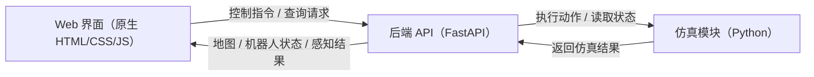

# 项目架构与接口

## 架构图



## 模块职责

| 模块 | 职责 | 代码目录或入口 |
| --- | --- | --- |
| Web 界面 | 按钮与键盘事件、发送请求、绘制地图与状态、展示异常提示 | `frontend/` |
| 后端 API | 解析请求、校验参数、调用仿真逻辑、组织 JSON 响应 | `backend/app/api/routes.py` |
| 仿真逻辑 | 地图世界、机器人移动规则、A* 规划、传感器扫描、巡检状态机与并发保护 | `backend/app/simulator/` |
| 应用入口 | 创建仿真实例、注册路由、托管静态页面 | `backend/app/main.py` |

## 数据约定

- **坐标系**：网格地图，原点左上角，`x` 为列、`y` 为行，单位为 1 格；地图尺寸 12×10。
- **地图表示**：障碍物与检查点用坐标点列表表示；可通行格为不在障碍物列表内的格。
- **机器人状态字段**：`x`、`y` 为坐标；`dir` 为朝向（`up/down/left/right`）；`dirLabel` 为朝向中文；`status` 为运行状态（`idle 空闲 / moving 巡检行进中 / blocked 移动受阻 / error 异常停止`）。
- **运行统计字段**：`stats.steps` 为累计移动步数；`stats.pathLength` 为累计规划路径格数；`stats.elapsed` 为运行耗时（秒，保留一位）；`stats.coverage` 为检查点覆盖率（0~1）。
- **前端取状态时机**：页面加载时拉取一次；操作后按响应刷新；巡检进行中每 500ms 轮询 `/api/state`。

## 接口约定

| 用途 | 方法与路径 | 请求参数 / 请求体 | 成功响应 | 失败响应 |
| --- | --- | --- | --- | --- |
| 获取地图与状态 | `GET /api/state` | — | `200`，完整状态 JSON | — |
| 手动控制 | `POST /api/move` | `{"direction":"right"}` | `200`，移动后完整状态 | `400 invalid_request`；`409 out_of_bounds`；`409 obstacle` |
| 路径规划 | `POST /api/plan` | `{"target":{"x":9,"y":2}}`，可选 `start` | `200`，`{ok:true, path:[...]}` | `200`，`{ok:false, reason:"..."}` |
| 传感器读数 | `GET /api/sensor` | — | `200`，`{direction, blocked, hit, distance, ahead}` | — |
| 启动自动巡检 | `POST /api/patrol/start` | — | `200`，完整状态 | — |
| 停止自动巡检 | `POST /api/patrol/stop` | — | `200`，完整状态 | — |
| 手动返航 | `POST /api/return-home` | — | `200`，完整状态 | — |
| 切换地图障碍 | `POST /api/map/toggle` | `{"x":5,"y":5}` | `200`，完整状态 | `400 invalid_request`；`409 out_of_bounds` |
| 动态障碍开关 | `POST /api/map/dynamic` | `{"enabled":true}` | `200`，完整状态 | — |
| 复位机器人 | `POST /api/reset` | — | `200`，初始状态 | — |

错误响应统一格式：

```json
{"error": {"code": "obstacle", "message": "前方有障碍物，无法移动"}}
```

未匹配的 `/api/` 路径返回 `404 not_found`；不支持的请求方法由框架返回 `405`。
