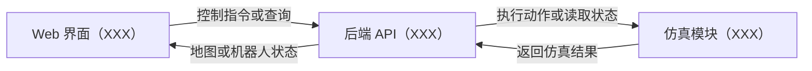

# 项目架构与接口

按实际实现补全下方架构图，或替换为自己的图。展示 Web 界面、后端 API 和仿真逻辑如何配合，以及控制指令和状态数据如何传递。

## 架构图

| 模块 | 实际职责 | 代码目录或入口 |
| --- | --- | --- |
| Web 界面 | XXX | XXX |
| 后端 API | XXX | XXX |
| 仿真逻辑 | XXX | XXX |

## 数据约定

- 地图坐标原点、坐标方向和单位为 `XXX`。
- 地图、边界和障碍物的表示方式为 `XXX`。
- 机器人位置、朝向和运行状态的字段含义为 `XXX`。
- 前端获取最新状态的时机和方式为 `XXX`。

## 接口约定

填写项目实际使用的接口。按需补充自动巡检、路径规划和传感器接口。

| 用途 | 方法与路径 | 请求参数或请求体示例 | 成功响应示例 | 失败响应示例 |
| --- | --- | --- | --- | --- |
| 获取地图 | XXX | XXX | XXX | XXX |
| 获取机器人状态 | XXX | XXX | XXX | XXX |
| 发送手动控制指令 | XXX | XXX | XXX | XXX |

可执行的请求命令和预期结果填写在[后端 README](../backend/README.md)。
